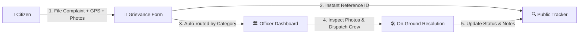

# CivicConnect 🏛️
### Smart Citizen Grievance & Municipal Resolution Platform

CivicConnect is an easy-to-use, multilingual web platform designed to bridge the gap between citizens and municipal authorities. It allows residents to quickly report local civic issues—such as potholes, broken drainage, garbage dumps, water supply problems, and illegal tree felling—directly to the responsible city department, track resolution progress in real time, and verify work with photographic proof and live GPS location.

---

## 🌟 Why CivicConnect?

In most cities, reporting a civic problem is frustrating:
* **No Evidence**: Traditional forms only ask for text descriptions, making it hard for authorities to know if an issue is real or how serious it is.
* **Vague Addresses**: Citizens often type landmark descriptions that field workers cannot locate on the ground.
* **Language Barriers**: Many portals only work in English, leaving out millions of residents who prefer their regional language.
* **No Transparency**: Once a complaint is filed, citizens rarely know if anyone is working on it.

**CivicConnect solves all of these problems in one clean, connected system.**

---

## 🚀 Key Features

### 1. 📍 Live GPS Location & Interactive Map Pin
* Citizens don't have to struggle typing long addresses.
* Tap **"Use My Current Location"** to automatically detect your live location using your phone or laptop GPS.
* An interactive map opens where you can drag and drop a pin to pinpoint the exact spot of the problem (e.g. the exact pothole or broken pipe).
* The street address updates automatically.

### 2. 📷 Mandatory Photo Proof Upload (1 to 6 Images)
* Every complaint requires photographic proof so municipal teams can verify the issue before sending resources.
* Upload **1 to 6 clear photos** directly from your device (JPG, PNG, or WebP).
* Live preview cards show each photo with its file size before submitting.

### 3. 🌐 4 Regional Languages (Instant Switching)
* Fully accessible in 4 languages:
  * 🇬🇧 **English**
  * 🇮🇳 **हिन्दी (Hindi)**
  * 🇮🇳 **தமிழ் (Tamil)**
  * 🇮🇳 **ಕನ್ನಡ (Kannada)**
* Switch languages anytime using the dropdown menu in the top navigation bar.
* All forms, buttons, GPS prompts, upload instructions, and tracking details translate immediately without reloading the page.

### 4. 🔍 Live Complaint Tracking
* When you file a complaint, you receive an instant reference number (like `CC-2026-8942`).
* Track resolution on a visual 3-step timeline:
  1. **Received & Queued**
  2. **Field Team Active (In Progress)**
  3. **Work Completed & Closed (Resolved)**
* Read official notes posted directly by the field supervisor working on the issue.
* View the photos you originally submitted.

### 5. 🛡️ Municipal Officer Dashboard & Evidence Inspector
* A dedicated, password-protected portal for city engineers, tree authority officers, and municipal staff.
* **Live Complaints Queue**: Filter and search complaints by reference ID, locality, status, or category.
* **Evidence Inspector (Photo Lightbox)**: Officers can click any uploaded photo to inspect it in high resolution, zoom in to evaluate problem severity, and cycle through photos using previous/next controls.
* **Status Updates**: Officers can change the status (*Pending Review* ➔ *In Progress* ➔ *Resolved*) and write transparent resolution notes that update the citizen's tracker instantly.

---

## 🧭 How the Platform Works



---

## 💻 Pages & Navigation

| Page | URL | Description |
| :--- | :--- | :--- |
| **File a Complaint** | `/file-complaint` | Citizen form to select a category, pick GPS location, upload 1–6 proof photos, and submit. |
| **Track a Complaint** | `/track-complaint` | Enter any reference ID (e.g. `CC-2026-8942`) to see the live timeline, field notes, and action plan. |
| **Officer Login** | `/department-login` | Secure portal for municipal staff with 1-click test officer credentials. |
| **Department Dashboard** | `/department-dashboard` | Officer command center to review tickets, inspect photo evidence, and update resolution status. |

---

## 📂 Project Structure

```
citizen_/
├── data/
│   ├── civicconnect.db          # Fast, reliable database storing all complaints
│   └── complaints.json          # Initial sample complaints and backup data
├── services/
│   ├── ai_analysis_service.py   # Analyzes complaints and generates ground action plans
│   ├── auth_service.py          # Officer login credentials and protected access
│   ├── complaints_store.py      # Connects web requests to the database
│   ├── database.py              # Stores complaints and handles updates reliably
│   ├── location_service.py      # Validates Indian addresses and landmarks
│   └── translation_service.py   # Translates dynamic notes into regional languages
├── static/
│   ├── css/
│   │   └── civicconnect.css     # Clean, modern, responsive styling
│   ├── js/
│   │   ├── civicconnect.js      # Interactive features (GPS, map pin, photo uploads, modals)
│   │   └── translations.js      # Built-in Hindi, Tamil, and Kannada translations
│   └── uploads/complaints/      # Folder where uploaded proof images are saved
├── templates/
│   ├── base.html                # Main layout, top navigation, and language switcher
│   ├── file_complaint.html      # Citizen complaint submission page
│   ├── track_complaint.html     # Citizen complaint tracking page
│   ├── department_login.html    # Officer login page
│   └── department_dashboard.html# Officer queue and photo evidence inspection modal
├── app.py                       # Main application server
├── requirements.txt             # List of required Python packages
├── README.md                    # Project documentation
└── .env.example                 # Example settings file
```

---

## 🛠️ Getting Started (Run Locally)

### 1. Requirements
Make sure you have **Python 3.10 or newer** installed on your computer.

### 2. Install Dependencies
Open PowerShell or your command prompt in the project folder and run:
```bash
pip install -r requirements.txt
```

### 3. Start the Server
Run the main app file:
```bash
python app.py
```

### 4. Open in Your Browser
Once started, the website is live at:
👉 **http://127.0.0.1:5000**

---

## 🔑 Demo Officer Accounts (For Easy Testing)

On the **Officer Login** page (`/department-login`), click any of the 1-click test buttons or use the credentials below:

| Role / Title | Email / Badge ID | Password | Department |
| :--- | :--- | :--- | :--- |
| **Chief Tree Officer** | `tree.officer@civicconnect.gov.in`<br>*(or `TREE-OFF-101`)* | `officer@trees2026` | Tree Authority, Green Belts & Parks |
| **Executive Engineer** | `pwd.officer@civicconnect.gov.in`<br>*(or `PWD-ENG-204`)* | `officer@pwd2026` | Roads, Potholes, Drainage & Water Supply |
| **Municipal Commissioner** | `admin@civicconnect.gov.in`<br>*(or `ADM-DIR-001`)* | `admin@civic2026` | City-wide Municipal Administration |

---

## 💡 Summary of Built Capabilities

* **No guesswork on locations**: GPS + Leaflet map pin for exact real-world coordinates.
* **No fake complaints**: Mandatory photo proof (1–6 photos) inspected by authorities.
* **Inclusive for everyone**: Works in English, Hindi, Tamil, and Kannada with zero lag.
* **Accountable city governance**: Officers inspect evidence, post public resolution updates, and move tickets from *Pending* to *Resolved*.
